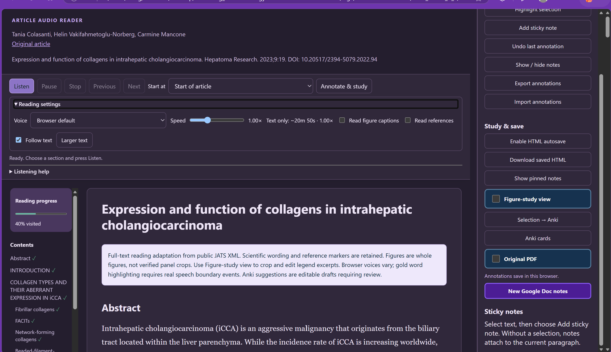
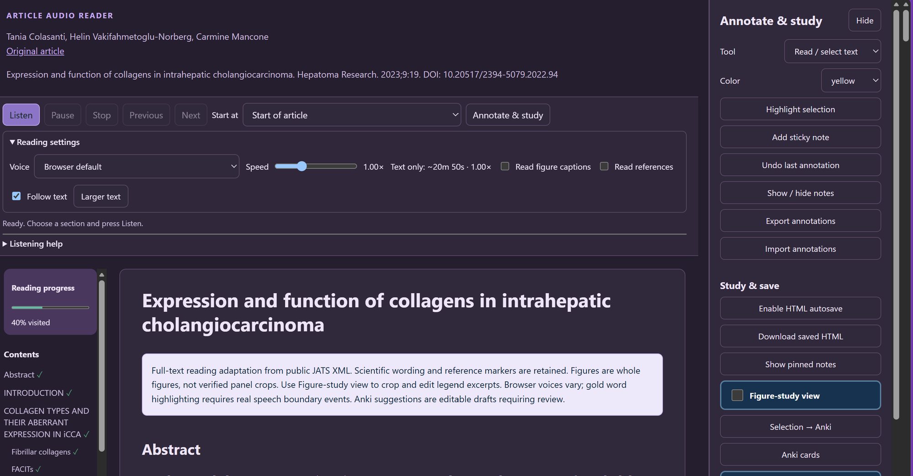
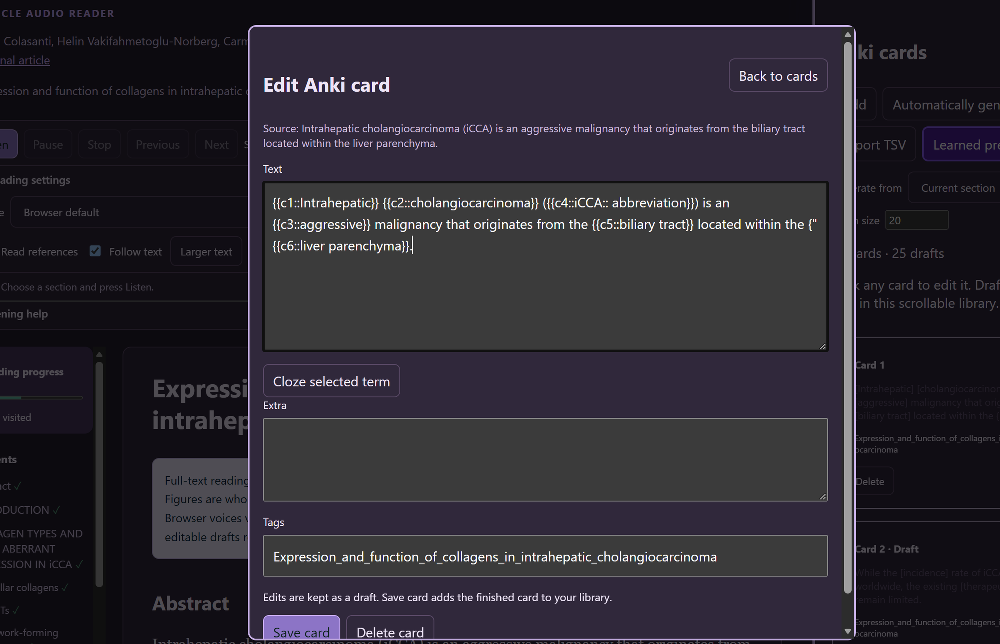

# Power Annotate: HTML Audio and Study Reader

`power_annotate` (formerly `html_aud`) is an agent skill that turns a scholarly article into a **single, standalone HTML file** you can listen to, annotate, and study from. It needs no server, no accounts, and no external runtime dependencies. Open the file in Edge or Chrome and it works.

## Screenshots

**Reader with the Annotate & study sidebar**



**Annotation tools**



**Anki card editor**



## Features

### Listen
- Listen, Pause/Resume, Stop, previous/next sentence, section jump, voice picker, and speed control
- Word-level highlighting driven by real speech word-boundary events (gold word on a green paragraph background). Timing is never estimated.
- Approximate text-only reading-time estimate next to the speed control (180 words/minute at 1x by default). It excludes captions, references, headings, and page images.
- Optional narration of captions and references; inline citation markers are skipped in narration but stay visible
- Follow-text scrolling, larger type, and figure zoom
- Compact contents column with the active section, visited sections, and cumulative reading progress

Voice support varies by browser and operating system.

### Layout
Playback and section controls stay at the top, with voice, speed, and other options in an expandable **Reading settings** group. Annotation tools, study toggles, save/export actions, Google Docs notes, and the Anki launcher live in a collapsible, independently scrolling right sidebar. On narrow screens the sidebar starts collapsed and opens as a drawer.

### Annotate
- **Post-it mode**: the Add sticky note button toggles persistent placement. Click anywhere on the text or figure-study surface to drop an editable note there, and placement stays on for the next note.
- Pencil, text highlighter, rectangle, ellipse, arrow, star, line, eraser, and undo
- The same tools work in the figure-study view, anchored to stable row, quote, and image identifiers
- Notes can be dragged, listed, and shown or hidden. Note text is never read aloud.

### Save your work (portable)
- Notes, drawings, card drafts, panel crops, legend edits, and progress save automatically to browser storage
- **Enable HTML autosave** uses the browser's native save picker to write snapshots into your reader file. Permission may need reconnecting after you reopen it.
- **Download saved HTML** is the fallback where direct file writing is unavailable
- Annotation JSON export and import
- State is embedded in the HTML, so it restores even when browser storage is empty

Browser pages cannot silently overwrite local files. The picker always needs your approval.

### Figure-study view
A two-column layout shows the sentence citing a figure panel and its legend excerpt on the left, and the matching panel crop on the right.
- Repeated citations stay separate, and combined citations like `Fig. 4b,c` show both panels
- Built-in crop-rectangle editor and editable legend text
- Uncropped figures and original pages are labeled as such, never as verified panel screenshots

### Original PDF toggle
Glance at the source PDF without leaving your current article or figure-study view. Embed the real PDF at build time:

```bash
python scripts/add_annotations.py --pdf SOURCE.pdf READER.html
```

Readers without an embedded PDF fall back to a local file chooser. The embedded PDF is kept in saved HTML snapshots.

### New Google Doc notes button
Every reader has a **New Google Doc notes** button, with no setup or template needed. Clicking it:
1. Builds an article-specific notes template locally: full citation, DOI link, Abstract, Introduction, one section per figure (using the real caption title), Discussion, and Additional
2. Copies it as rich text to your clipboard (plain-text fallback) and opens a new Google Doc in a separate tab
3. You paste once

If clipboard access fails, a dialog shows the template with **Copy template** and **Open Google Docs** buttons. The standalone HTML never creates or fills an authenticated Google Doc and embeds no credentials or tokens.

Optionally, add `<link id="google-notes-template" href="https://docs.google.com/document/d/VERIFIED_ID/copy">` and the button opens Google's Make a copy flow for your own native template.

### Anki cards
- Select a term or sentence to create a source-linked draft. A short selected term keeps its source-sentence context.
- **Automatic cloze suggestions** for every sentence in the selected section, or the whole article with a batch limit. Suggestions are deduplicated, editable, and never cloze an entire sentence. They use deterministic local selection, not a remote AI call, so review them for accuracy.
- **Card library**: a scrollable list with previews. Click a card to open the editor (Text, Extra, Tags, cloze-term insertion, Save card, Back to cards, Delete card). Saving validates a `c1` cloze.
- The article title becomes the single Anki tag, with whitespace replaced by underscores.
- Cloze numbering restarts at `c1` in each note
- Exports Anki-compatible three-field TSV with proper multiline quoting. Incomplete drafts are kept but skipped, with a visible count.
- Brief heart-confetti celebration when you save a card or generate a batch (reduced-motion aware)
- Card style follows [`references/mcat-cloze-rules.md`](references/mcat-cloze-rules.md)

### Learned preferences
Inside the Anki panel, **Learned preferences** records how you edit suggested cards (before/after examples, counts of distinct edited cards) and, after at least three distinct edited cards, lets the style preference shape future suggestions, such as shorter clozes and fewer deletions. It has a learning switch, per-preference disable and delete, reset, JSON export, and a copyable skill-update report. Existing cards are never touched.

This history is stored locally in the browser and saved HTML. Copying the report does not modify the skill automatically, and scientific wording changes are flagged for review rather than learned as rules.

## Install

Copy this folder into your agent's skills directory (for example `~/.codex/skills/power_annotate/`). Then ask:

```
Use $power_annotate to turn this article into an HTML audio reader.
```

The skill also responds to `/power_annotate` and to article listening or study requests.

## Usage

Python 3 is required. The scripts also need `lxml`.

**From PMC/JATS XML:**
```bash
python scripts/build_reader.py --xml ARTICLE.xml --assets-dir IMAGE_FOLDER --output READER.html
```

**From extracted text (for example, a PDF):**
```bash
python scripts/build_from_json.py --input ARTICLE.json --output READER.html
```

```json
{
  "title": "Article title",
  "citation": "Authors. Journal. Year. DOI",
  "url": "https://doi.org/...",
  "notice": "Optional note, e.g. partial text",
  "blocks": [
    {"text": "Introduction", "tag": "h2"},
    {"text": "Paragraph text.", "tag": "p", "kind": "text"},
    {"text": "Figure 1. Caption.", "kind": "caption"}
  ],
  "page_images": [{"label": "Page 1", "src": "data:image/png;base64,..."}],
  "footer": "Optional footer"
}
```

**Upgrade an existing reader** (back it up first), optionally embedding the original PDF:
```bash
python scripts/add_annotations.py READER.html
python scripts/add_annotations.py --pdf SOURCE.pdf READER.html
```

## Repository layout

```
SKILL.md                        Skill definition and rules for the agent
agents/openai.yaml              Display name and default prompt
assets/                         Reader template, annotation and study CSS/JS
references/mcat-cloze-rules.md  Cloze card requirements
scripts/                        build_reader.py, build_from_json.py, add_annotations.py
```

## Principles

- Preserve the article's scientific text, inline formatting, attribution, and figure order
- Never invent missing text or citation details, and never bypass access restrictions. Label partial-text readers clearly.
- Figures and original page images go at the end of the document
- Nothing is uploaded to external services without your authorization

## Rights

Readers are reading-format adaptations. Respect each article's license and consult the original for publication and rights information.
